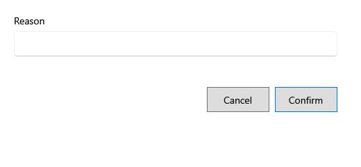

<!-- MT – needs review. Screen help for a bill's Void (topic "sale-void"); the English file is ../en/sale-void.md. Bold names in a table's first column must match the Gujarati labels on screen; see ../README.md. -->
# બિલ રદ કરો

ભૂલથી બનેલું બિલ રદ કરો.

રદ કરવાથી બિલનો બધો સ્ટોક તેની બેચમાં પાછો જાય છે અને બિલ તેના દિવસના વેચાણમાંથી નીકળી જાય છે; બિલ રદ તરીકે યાદીમાં રહે છે. ફક્ત પરત વગરનું પૂર્ણ બિલ, બંધ ન થયેલા વર્ષમાં, રદ થઈ શકે; સેટિંગ્સ ફક્ત એ જ દિવસે રદ કરવા દે ત્યાં સુધી, ફક્ત આજનાં બિલ. થોડી વસ્તુઓ પાછી લેવા, તેના બદલે પરત વાપરો.

## ખાનાં

| ખાનું | અર્થ |
|---|---|
| **કારણ** | બિલ કેમ રદ થાય છે. જરૂરી. |

## બટન

| બટન | શું કરે છે |
|---|---|
| **પુષ્ટિ કરો** | બિલ રદ કરે છે. |
| **રદ કરો** | ફેરફાર વગર બંધ કરે છે. |
