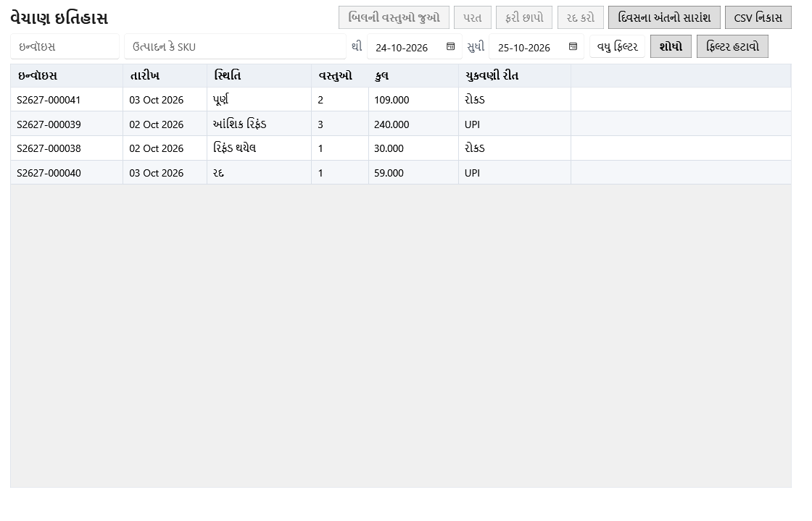

<!-- MT – needs review. Screen help for Sales history (topic "sales-history"); the English file is ../en/sales-history.md. Bold names in a table's first column must match the Gujarati labels on screen; see ../README.md. -->
# વેચાણ ઇતિહાસ

પૂરાં થયેલાં બિલ શોધો, દરેકમાં શું વેચાયું તે જુઓ, અને ફરી છાપો, રદ કરો કે વસ્તુઓ પરત લો. દિવસના અંતનો સારાંશ પણ અહીં છે.

ક્રિયાઓ કોષ્ટકમાં પસંદ કરેલા બિલ પર લાગુ થાય છે.

## ફિલ્ટર

ફિલ્ટર ગોઠવો, પછી **શોધો** પર ક્લિક કરો અથવા કોઈપણ ખાનામાં Enter દબાવો.

| ખાનું | અર્થ |
|---|---|
| **ઇન્વૉઇસ** | ઇન્વૉઇસ નંબર, અથવા તેની શરૂઆત લખો. Ctrl+F અહીં લાવે છે. |
| **ઉત્પાદન કે SKU** | જે ઉત્પાદનનું વેચાયેલું નામ કે SKU તમે લખો તેનાથી શરૂ થતું હોય એવાં બિલ. |
| **થી**, **સુધી** | આ દિવસો વચ્ચેનાં બિલ. |
| **સ્થિતિ** | **કોઈપણ સ્થિતિ**, **પૂર્ણ**, **આંશિક રિફંડ** (કેટલીક વસ્તુઓ પરત આવી), **રિફંડ થયેલ** (બધું પરત આવ્યું) અથવા **રદ**. |
| **વધુ ફિલ્ટર** | ગ્રાહક, ચુકવણી રીત અને બિલની કુલ રકમ સાથે બીજી લીટી બતાવે છે. |
| **ગ્રાહક** | જે ગ્રાહકનું નામ કે ફોન નંબર તમે લખો તેનાથી શરૂ થતો હોય તેનાં બિલ. |
| **ચુકવણી રીત** | **કોઈપણ ચુકવણી**, **મળેલી રોકડ**, **UPI** અથવા **કાર્ડ**: ઓછામાં ઓછું અંશતઃ એ રીતે ચૂકવાયેલાં બિલ. |
| **બિલની કુલ રકમ**, **ઓછામાં ઓછું ₹**, **વધુમાં વધુ ₹** | જેની કુલ રકમ આ મર્યાદામાં હોય એવાં બિલ. |
| **શોધો** | ફિલ્ટરને મળતાં બિલ બતાવે છે (Enter). |
| **ફિલ્ટર હટાવો** | દરેક ફિલ્ટર તેની મૂળ સ્થિતિમાં લાવે છે. |

## કોષ્ટક

| કૉલમ | અર્થ |
|---|---|
| **ઇન્વૉઇસ** | બિલનો નંબર, ચુકવણી વખતે મળેલો. |
| **તારીખ** | બિલ ચૂકવાયું તે દિવસ. |
| **સ્થિતિ** | પૂર્ણ, આંશિક રિફંડ, રિફંડ થયેલ અથવા રદ. |
| **વસ્તુઓ** | બિલમાં કેટલી લાઇન છે. |
| **કુલ** | ગ્રાહકે ચૂકવેલી રકમ. |
| **ચુકવણી રીત** | બિલ કેવી રીતે ચૂકવાયું: રોકડ, UPI, કાર્ડ કે મિશ્ર. |

## બટન

| બટન | શું કરે છે |
|---|---|
| **બિલની વસ્તુઓ જુઓ** | પસંદ કરેલું બિલ પૅનલમાં ખોલે છે (Enter કે ડબલ-ક્લિક). |
| **પરત** | બિલમાંથી વસ્તુઓ પાછી લે છે. દરેક બેચ માટે વેચાયેલો, પહેલેથી પરત થયેલો અને હજી પરત થઈ શકે એટલો જથ્થો, રિફંડ, અને સ્ટોક ક્યાં જશે તે બતાવે છે: વેચાણ પછી બેચ બદલાઈ ન હોય તો એ જ બેચમાં, નહીં તો નવી પરત બેચમાં, અથવા વસ્તુ નુકસાનવાળી કે સમાપ્ત હોય તો નુકસાનમાં. |
| **ફરી છાપો** | સાચવેલી રસીદ ફરી છાપે છે. |
| **બિલ રદ કરો** | ભૂલથી બનેલું બિલ કારણ સાથે રદ કરે છે અને તેનો સ્ટોક પાછો મૂકે છે. ફક્ત પરત વગરનું પૂર્ણ બિલ, બંધ ન થયેલા વર્ષમાં; સેટિંગ્સ ફક્ત એ જ દિવસે રદ કરવા દે ત્યાં સુધી, ફક્ત આજનાં બિલ. |
| **દિવસના અંતનો સારાંશ** | આજનું વેચાણ, રિફંડ, કર અને રીત મુજબ ચુકવણી, ખાનામાં અપેક્ષિત રોકડ સાથે: રોકડ વેચાણ બાદ રોકડ રિફંડ અને આજના રોકડ ખર્ચ, જેવા હાલમાં છે તેવા. |
| **CSV નિકાસ** | ફિલ્ટરને મળતું દરેક બિલ CSV ફાઇલમાં સાચવે છે, પહેલી લીટીમાં ફિલ્ટર અને છેલ્લીમાં કુલ સાથે. **રદ કરો** તેને અટકાવે છે. |
| **વધુ ▾** | વિન્ડો સાંકડી હોય ત્યારે ન સમાતી ક્રિયાઓ રાખે છે. |

## બિલની પૅનલ

બિલ યાદીની બાજુમાં ખૂલે છે; બીજું બિલ પસંદ કરવાથી તે દેખાય છે. એ ખુલ્લી હોય ત્યારે **પરત**, **ફરી છાપો** અને **બિલ રદ કરો** પૅનલમાં હોય છે. તેના શીર્ષકમાં બિલનો નંબર, અને નીચે તારીખ અને સ્થિતિ હોય છે. ટૅબ નીચે હંમેશાં દેખાતી લીટી બિલની **મૂળ રકમ**, હોય તો **ડિસ્કાઉન્ટ**, **વસૂલેલો કર**, હોય તો **રાઉન્ડ ઓફ** અને **બિલની કુલ રકમ**, પછી દરેક રીતે ચૂકવેલી રકમ અને રોકડમાંથી પાછી આપેલી **પરત રકમ**, હોય તો, બતાવે છે.

| ખાનું | અર્થ |
|---|---|
| **પાછલી નોંધ**, **આગળની નોંધ** | યાદીમાં ઉપરનું કે નીચેનું બિલ ખોલે છે. |
| **પૂરી પહોળાઈ વાપરો**, **યાદીની બાજુમાં બતાવો** | પૅનલને યાદીની બાજુ અને આખા પાના વચ્ચે બદલે છે. સ્ક્રીન આ પસંદગી યાદ રાખે છે. |
| **બંધ કરો** | પૅનલ બંધ કરે છે (Esc). |

## વસ્તુઓ

કોષ્ટક બાજુમાં સરકે ત્યારે નામ દેખાતું રહે છે. કર પહેલાં + વસૂલેલો કર = કુલ, જેમ દેખાય છે તેમ.

| કૉલમ | અર્થ |
|---|---|
| **નામ**, **SKU** | ઉત્પાદન, વેચાયું ત્યારે હતું તેમ. |
| **બેચ કોડ**, **બેચ નંબર**, **સમાપ્તિ** | જે બેચમાંથી વસ્તુ વેચાઈ. |
| **જથ્થો** | વેચાયેલો જથ્થો. |
| **વેચાણ કિંમત** | એક એકમની કિંમત, કર સહિત. |
| **ખરીદ કિંમત** | એ બેચના એક નંગની કર પહેલાંની કિંમત. |
| **કર સહિત ખરીદ કિંમત** | એ બેચના એક નંગની કિંમત, કર સહિત. |
| **કર** | વસૂલેલા કર દરનું નામ, જેમ કે "GST 5%", અથવા કમ્પોઝિશન કે GST વગરની પદ્ધતિમાં "—". લાઇન ઉમેર્યા પછી દરના ટકા બદલાયા હોય તો લાઇન પોતાના ટકા બતાવે છે. |
| **કર પહેલાં** | ડિસ્કાઉન્ટ પછી, કર પહેલાંની લાઇનની રકમ. |
| **વસૂલેલો કર** | લાઇન પર ગ્રાહક પાસેથી વસૂલેલો કર. |
| **કુલ** | લાઇનની કુલ રકમ. |

## પરત

| કૉલમ | અર્થ |
|---|---|
| **પરત** | પરતનો નંબર. |
| **તારીખ** | પરતનો દિવસ. |
| **નામ** | પરત આવેલું ઉત્પાદન. |
| **બેચ કોડ** | જે બેચમાં જથ્થો પાછો ગયો. |
| **જથ્થો** | કેટલું પાછું આવ્યું. |
| **રિફંડ** | પાછી આપેલી રકમ. |
| **સ્ટોક ક્યાં જશે** | **મૂળ બેચ**, **નવી પરત બેચ** અથવા **નુકસાનવાળી**. |
| **કારણ** | પરત માટે આપેલું કારણ. |

## પ્રવૃત્તિ

| કૉલમ | અર્થ |
|---|---|
| **તારીખ** | ક્યારે થયું. |
| **નામ** | સંબંધિત ઉત્પાદન. |
| **બેચ કોડ** | સંબંધિત બેચ. |
| **ઘટના** | શું થયું: પૂર્ણ, આંશિક પરત, સંપૂર્ણ રિફંડ, નુકસાનવાળી પરત અથવા રદ. |
| **જથ્થો** | સંબંધિત જથ્થો. |

## કેવી રીતે વાપરવું

1. બિલ ફિલ્ટર કરો અને એક પસંદ કરો.
2. તેની વસ્તુઓ અને ચુકવણી તપાસવા તેને ખોલો.
3. કારણ સાથે ફરી છાપો, રદ કરો કે વસ્તુઓ પરત લો.
4. દુકાન બંધ કરતી વખતે દિવસના અંતનો સારાંશ તપાસો.
