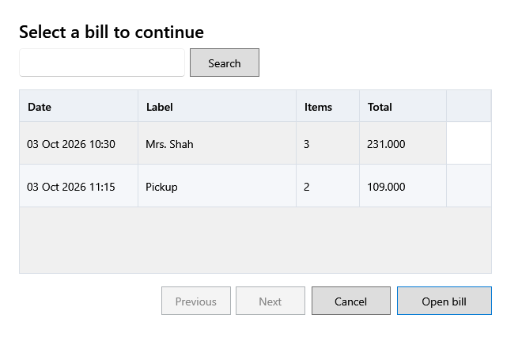

<!-- MT – needs review. Screen help for Saved bills (topic "saved-bills"); the English file is ../en/saved-bills.md. Bold names in a table's first column must match the Gujarati labels on screen; see ../README.md. -->
# સાચવેલા બિલ

રોકેલું કે અધૂરું રહેલું બિલ શોધો અને તેના પર આગળ વધો.

**F8 ફરી શરૂ કરો** રોકેલાં બિલ, નવાં પહેલાં, બતાવે છે. બિલિંગ ખૂલે ત્યારે અધૂરાં બિલ બાકી હોય તો તે પણ દેખાય છે. રોકેલું બિલ ખૂલે તે પહેલાં, રોક્યા પછી બદલાયેલી કિંમત કે સ્ટોકની તપાસ દેખાય છે.

## ખાનાં

| ખાનું | અર્થ |
|---|---|
| **બિલ # કે લેબલ** | બિલનો નંબર, અથવા તેના લેબલનો ભાગ. |

## કોષ્ટક

| કૉલમ | અર્થ |
|---|---|
| **તારીખ** | બિલ ક્યારે શરૂ થયું. |
| **લેબલ** | રોકતી વખતે આપેલું લેબલ. |
| **વસ્તુઓ** | તેમાં કેટલી લાઇન છે. |
| **કુલ** | બાજુએ મૂક્યું ત્યારે તેની રકમ. |

## બટન

| બટન | શું કરે છે |
|---|---|
| **શોધો** | નંબર કે લેબલને મળતાં બિલ બતાવે છે. |
| **બિલ ખોલો** | પસંદ કરેલું બિલ ખોલે છે. ડબલ-ક્લિક પણ એ જ કરે છે. |
| **દર પાનાના રેકોર્ડ**, **પાછળ**, **આગળ** | સમાય તેના કરતાં વધુ બિલ હોય ત્યારે તેમાં આગળ-પાછળ જાય છે. |
| **રદ કરો** | બિલ ખોલ્યા વગર બંધ કરે છે. |
