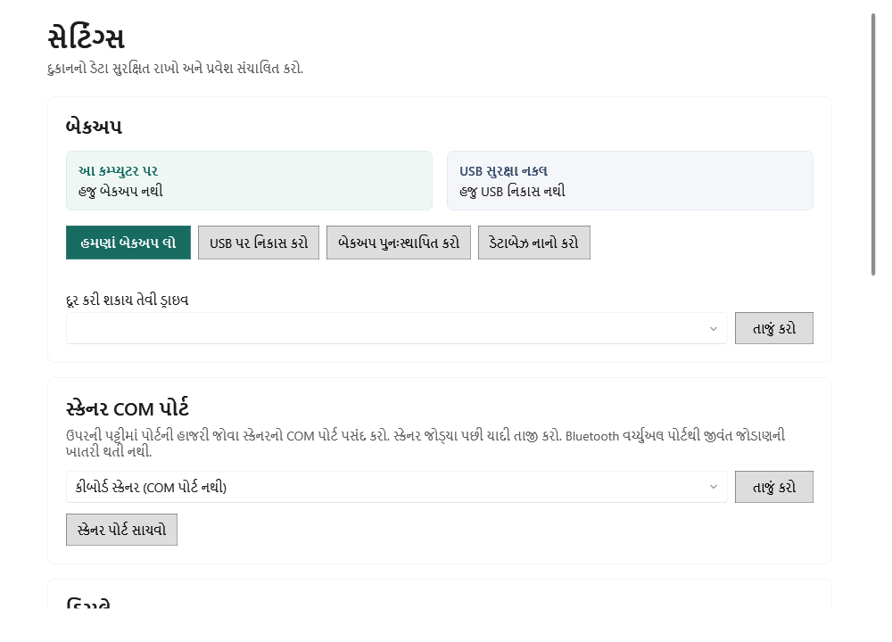

<!-- MT – needs review. Screen help for Settings (topic "settings"); the English file is ../en/settings.md. Bold names in a table's first column must match the Gujarati labels on screen; see ../README.md. -->
# સેટિંગ્સ

બેકઅપ વડે દુકાનનો ડેટા સુરક્ષિત રાખો, તેને પુનઃસ્થાપિત કરો કે નાનો કરો, અને સ્કેનર પોર્ટ, દોરવાની રીત, ડેટા ફોલ્ડર અને માલિકનો પાસવર્ડ ગોઠવો.

એપ દસ મિનિટ નિષ્ક્રિય રહે પછી દિવસમાં એક વાર જાતે બેકઅપ લે છે. બેકઅપ નિયમિત USB ડ્રાઇવ પર નકલ કરો અને ડ્રાઇવ કમ્પ્યુટરથી દૂર રાખો.

## બેકઅપ

| ખાનું | અર્થ |
|---|---|
| **આ કમ્પ્યુટર પર** | આ કમ્પ્યુટર પર છેલ્લો બેકઅપ ક્યારે લેવાયો. |
| **USB સુરક્ષા નકલ** | બેકઅપ છેલ્લે ક્યારે USB ડ્રાઇવ પર નકલ થયા. |
| **હમણાં બેકઅપ લો** | અત્યારે બેકઅપ લે છે અને તે પાછો વાંચી શકાય છે તે ચકાસે છે. |
| **USB પર નિકાસ કરો** | નીચે પસંદ કરેલી ડ્રાઇવ પર બેકઅપની નકલ કરે છે અને દરેક નકલ ચકાસે છે. |
| **બેકઅપ પુનઃસ્થાપિત કરો** | બેકઅપ ફાઇલ પસંદ કરો. એક વિન્ડો હાલના ડેટાને બેકઅપના ડેટા સાથે સરખાવે છે; પુનઃસ્થાપન ચાલુ કરવા તે માગે તે પુષ્ટિ લખો. પહેલાં હાલના ડેટાનો સુરક્ષા બેકઅપ લેવાય છે, પછી એપ બંધ થાય છે. પુનઃસ્થાપિત ડેટા તપાસવા કે પુનઃસ્થાપન પાછું ફેરવવા તેને ફરી ખોલો. |
| **ડેટાબેઝ નાનો કરો** | ડેટાબેઝની કેટલી જગ્યા વપરાયા વગરની છે તે બતાવે છે. તમે પુષ્ટિ કરો પછી એપ બંધ થાય છે; આગલા સાઇન ઇન પર, મુખ્ય વિન્ડો ખૂલે તે પહેલાં, તે એ જગ્યા વગર ડેટાબેઝની નકલ બનાવે છે, નકલમાં દરેક રેકોર્ડ અને સરખા કુલ છે તે ચકાસે છે, તેને ચકાસાયેલ બેકઅપ તરીકે સાચવે છે અને તે વાપરવા લાગે છે. તેને ખાલી ડિસ્ક જગ્યા જોઈએ અને પૂરતી ન હોય તો કેટલી જોઈએ તે જણાવે છે. દુકાન બંધ હોય ત્યારે નાનો કરો. |
| **દૂર કરી શકાય તેવી ડ્રાઇવ** | બેકઅપની નકલ કરવા માટેની USB ડ્રાઇવ. |
| **તાજું કરો** | ડ્રાઇવ જોડ્યા પછી ડ્રાઇવ ફરી શોધે છે. |

બેકઅપ ક્યારે અને શા માટે લેવાયા તે મુજબ દેખાય છે. **સ્કીમા સંસ્કરણ N થી અપગ્રેડ પહેલાં** એ અપડેટે સાચવેલો બેકઅપ છે; અગાઉના સંસ્કરણ પર પાછા જવા તે સંસ્કરણ ઇન્સ્ટોલ કરીને આ બેકઅપ પુનઃસ્થાપિત કરો. **સ્ટોક ખાતાવહી દૂર કરતાં પહેલાં … કાયમ રાખેલો** ક્યારેય આપોઆપ કાઢી નખાતો નથી. **ડેટાબેઝ નાનો કરતાં પહેલાં** નાનો કરતાં પહેલાં સાચવેલી નકલ છે.

## સ્કેનર COM પોર્ટ

| ખાનું | અર્થ |
|---|---|
| **સ્કેનર COM પોર્ટ** | બારકોડ સ્કેનર જે સીરીયલ પોર્ટ વાપરે છે, જેથી શીર્ષક પટ્ટી તે જોડાયેલું છે કે નહીં તે બતાવી શકે. કીબોર્ડની જેમ લખતા સ્કેનર માટે **કીબોર્ડ સ્કેનર (COM પોર્ટ નથી)** પસંદ કરો. Bluetooth વર્ચ્યુઅલ પોર્ટ જીવંત જોડાણની ખાતરી કરી શકતો નથી. |
| **તાજું કરો** | સ્કેનર જોડ્યા પછી પોર્ટ ફરી બતાવે છે. |
| **સ્કેનર પોર્ટ સાચવો** | પસંદ કરેલો પોર્ટ સાચવે છે. |

## ડિસ્પ્લે

| ખાનું | અર્થ |
|---|---|
| **સ્ક્રીન દોરવા માટે ગ્રાફિક્સ કાર્ડ વાપરો** | મૂળ રીતે બંધ: એપ તેની સ્ક્રીન સૉફ્ટવેરથી દોરે છે, જેથી મેમરી ઓછી વપરાય છે. આ કમ્પ્યુટર પર સ્ક્રીન ધીમી લાગે તો જ ચાલુ કરો. ફેરફાર એપ ફરી શરૂ થયા પછી લાગુ થાય છે. |

## ડેટાના સ્થાન

| ખાનું | અર્થ |
|---|---|
| **ડેટા ફોલ્ડર** | દુકાનનો ડેટાબેઝ જ્યાં રાખેલો છે. |
| **ડેટા ફોલ્ડર ખસેડો** | ડેટા તમે પસંદ કરો તે ખાલી ફોલ્ડરમાં ખસેડે છે. પહેલાં ચકાસાયેલ બેકઅપ બને છે; એપ બંધ થાય છે અને તમે ફરી ખોલો ત્યારે ખસેડવાનું પૂરું કરે છે. |
| **બેકઅપ ફોલ્ડર** | બેકઅપ જ્યાં સચવાય છે. |

## માલિકનો પાસવર્ડ બદલો

| ખાનું | અર્થ |
|---|---|
| **હાલનો પાસવર્ડ** | તમે હાલ જે પાસવર્ડથી સાઇન ઇન કરો છો. |
| **નવો પાસવર્ડ (8 કે વધુ અક્ષરો)** | નવો પાસવર્ડ, ઓછામાં ઓછા આઠ અક્ષરનો. |
| **પાસવર્ડની પુષ્ટિ કરો** | નવો પાસવર્ડ ફરીથી. |
| **પાસવર્ડ સાચવો** | પાસવર્ડ બદલે છે. |

## કેવી રીતે વાપરવું

1. છેલ્લો બેકઅપ તાજેતરનો છે તે તપાસો, અથવા **હમણાં બેકઅપ લો** પર ક્લિક કરો.
2. USB ડ્રાઇવ જોડો, તેને પસંદ કરો અને **USB પર નિકાસ કરો** પર ક્લિક કરો. આ નિયમિત કરો.
3. શીર્ષક પટ્ટીમાં સ્કેનર અને પ્રિન્ટરની સ્થિતિ તપાસો.
4. પાછું મેળવવા, **બેકઅપ પુનઃસ્થાપિત કરો** વડે જાણીતો બેકઅપ પસંદ કરો, સારાંશ સરખાવો, પુષ્ટિ લખો અને પુનઃસ્થાપિત કરો.
5. મોટી સફાઈ પછી, ડેટાબેઝ એક વાર નાનો કરો.
