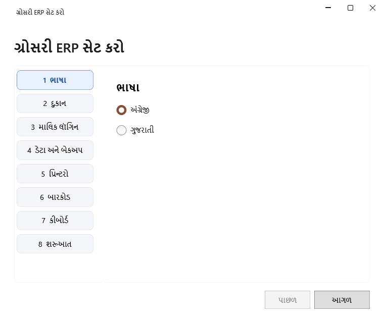

<!-- MT – needs review. Screen help for first-run setup (topic "setup"); the English file is ../en/setup.md. Each step is a tab; a section named as the tab opens with it. Bold names in a table's first column must match the Gujarati labels on screen; see ../README.md. -->
# ગ્રોસરી ERP સેટ કરો

એપ પહેલી વાર ખૂલે ત્યારે દુકાન સેટ કરો: ભાષા, દુકાન, માલિક લૉગિન, ડેટા અને બેકઅપ, પ્રિન્ટરો, બારકોડ અને કીબોર્ડ.

**આગળ** વડે પગલાં પૂરાં કરો. દરેક પગલું આગળનું ખૂલે તે પહેલાં તપાસાય છે, અને તમે જોયેલા કોઈપણ પગલા પર ક્લિક કરીને પાછા જઈ શકો છો. છેલ્લા પગલા પર **પૂર્ણ કરો** બધું સાચવે છે અને પહેલો બેકઅપ લે છે.

## 1 ભાષા

| ખાનું | અર્થ |
|---|---|
| **અંગ્રેજી**, **ગુજરાતી** | એપની સ્ક્રીન અને મદદની ભાષા. આંકડા હંમેશાં અંગ્રેજી અંકોમાં દેખાય છે. |

## 2 દુકાન

| ખાનું | અર્થ |
|---|---|
| **દુકાનનું નામ** | દુકાનનું નામ, રસીદ પર છપાય તેમ. જરૂરી. |
| **સરનામું**, **ફોન** | દુકાનનું સરનામું, જે રસીદ પર છપાય છે, અને તેનો ફોન નંબર. |
| **GSTIN** | દુકાનનો GST નંબર, 15 અક્ષર, અથવા ખાલી. તે લખવાથી તેના પહેલા બે અંકો પરથી **રાજ્ય** ભરાય છે. |
| **રાજ્ય** | દુકાનનું રાજ્ય. |
| **કર પદ્ધતિ** | **નિયમિત GST** દરેક બિલમાં કર બતાવે છે; **કમ્પોઝિશન** અને **નોંધાયેલ નથી** બિલમાં કર બતાવતા નથી. |

## 3 માલિક લૉગિન

પાસવર્ડ પુનઃપ્રાપ્ત કરવાની સુવિધા નથી. પાસવર્ડ સુરક્ષિત જગ્યાએ રાખો.

| ખાનું | અર્થ |
|---|---|
| **વપરાશકર્તા નામ** | સાઇન ઇન કરવા માટેનું નામ. |
| **પાસવર્ડ (8 કે વધુ અક્ષરો)** | સાઇન ઇન કરવા માટેનો પાસવર્ડ. |
| **પાસવર્ડની પુષ્ટિ કરો** | એ જ પાસવર્ડ ફરી. |

## 4 ડેટા અને બેકઅપ

| ખાનું | અર્થ |
|---|---|
| **ડેટા ફોલ્ડર** | દુકાનનો ડેટા જ્યાં રહે છે. |
| **ખાલી ડેટા ફોલ્ડર પસંદ કરો** | ડેટા તેના બદલે બીજા, ખાલી ફોલ્ડરમાં રાખે છે. |
| **બેકઅપ ફોલ્ડર** | બેકઅપ જ્યાં સચવાય છે. જરૂરી. OneDrive જેવો ક્લાઉડ સાથે સમન્વયિત ફોલ્ડર સ્વીકારાતો નથી. |
| **USB બેકઅપ યાદ અપાવવું** | બેકઅપ USB ડ્રાઇવમાં નકલ કરવાનું એપ કેટલી વાર યાદ અપાવે. |

## 5 પ્રિન્ટરો

પહેલાં દરેક પ્રિન્ટરનો Windows ડ્રાઇવર ઇન્સ્ટોલ કરો, અને પ્રિન્ટરનું નામ Windows બતાવે તેમ લખો. દુકાનમાં ન હોય તે પ્રિન્ટર ખાલી રાખો.

| ખાનું | અર્થ |
|---|---|
| **રસીદ પ્રિન્ટર** | બિલ અને દિવસના અંતના સારાંશ માટેનું પ્રિન્ટર. |
| **રસીદની પહોળાઈ** | રસીદ કાગળની પહોળાઈ, 58 કે 80 mm. |
| **રસીદ મોડ** | **રાસ્ટર (અંગ્રેજી અને ગુજરાતી)** ગુજરાતી પણ છાપે છે; **ટેક્સ્ટ (ફક્ત અંગ્રેજી)** સાદું અંગ્રેજી લખાણ છાપે છે. |
| **લેબલ પ્રિન્ટર** | કિંમત અને બારકોડ લેબલ માટેનું પ્રિન્ટર. |
| **લેબલનું માપ** | એક લેબલનું માપ. |
| **પરીક્ષણ છાપો** | બાજુના પ્રિન્ટર પર પરીક્ષણ પાનું છાપે છે. |

## 6 બારકોડ

એપ જે બારકોડ છાપે છે તે આમાંના એક બે-અંકના ઉપસર્ગથી શરૂ થાય છે, જેથી સ્કેન ઓળખે કે તે શું છે. અલગ ઉપસર્ગ વાપરો.

| ખાનું | અર્થ |
|---|---|
| **બેચ કોડ ઉપસર્ગ** | બેચના લેબલ પરના બારકોડની શરૂઆત. |
| **ઉત્પાદન ઉપસર્ગ** | ઉત્પાદનના લેબલ પરના બારકોડની શરૂઆત. |
| **વજનકાંટાના લેબલનો ઉપસર્ગ (વૈકલ્પિક, 2 અંક)** | વજનકાંટો છાપે તે બારકોડની શરૂઆત: ઉપસર્ગ, 5 અંકનો PLU, ગ્રામમાં 5 અંકનું વજન અને ચેક અંક. તમારા વજનકાંટાનું બંધારણ જુદું હોય તો ખાલી રાખો. |

## 7 કીબોર્ડ

ગુજરાતીમાં લખવા માટે Windows Settings → Time & language → Language & region માં ગુજરાતી ફોનેટિક કીબોર્ડ ઇન્સ્ટોલ કરો. આ પગલું કહે છે કે તે મળ્યું કે નહીં.

## 8 શરૂઆત

**પૂર્ણ કરો** સેટઅપ સાચવે છે અને પહેલો બેકઅપ લે છે. ઉત્પાદન યાદી ખાલીથી શરૂ થાય છે: ઉત્પાદનો પાનાં પર, એક પછી એક અથવા **Excel આયાત** વડે, ઉત્પાદનો ઉમેરો. શરૂઆતનો સ્ટોક પછીથી દાખલ કરી શકાય છે.

## બટન

| બટન | શું કરે છે |
|---|---|
| **પાછળ** | પહેલાંના પગલા પર જાય છે. |
| **આગળ** | આ પગલું તપાસીને આગળના પર જાય છે. |
| **પૂર્ણ કરો** | છેલ્લા પગલા પર: સેટઅપ સાચવે છે અને પહેલો બેકઅપ લે છે. |
| **બેકઅપ ફરી કરો** | પહેલો બેકઅપ નિષ્ફળ જાય ત્યારે દેખાય છે: બેકઅપ ફોલ્ડર તપાસો, પછી ફરી પ્રયાસ કરો. |
