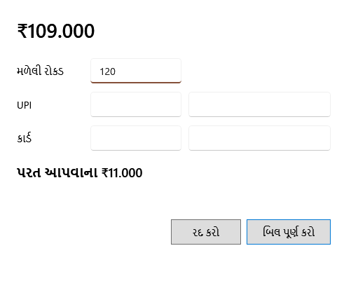

<!-- MT – needs review. Screen help for Take payment (topic "split-payment"); the English file is ../en/split-payment.md. Bold names in a table's first column must match the Gujarati labels on screen; see ../README.md. -->
# ચુકવણી લો

બિલની ચુકવણી રોકડ, UPI, કાર્ડ કે તેના મિશ્રણમાં લો, અને બિલ પૂર્ણ કરો.

ઉપરની રકમ બિલની રકમ છે. **F9 રોકડ** આ બધી રકમ રોકડમાં રાખીને ખોલે છે, **F10 UPI** બધી UPI માં, અને **F11 વિભાજિત** રોકડમાં, વહેંચવા માટે. ખાનાં નીચે, તમે લખો તેમ હજી કેટલું ચૂકવવાનું બાકી છે, અથવા કેટલા પૈસા પાછા આપવાના છે, તે દેખાય છે. બિલ પૂર્ણ કરવાથી સ્ટોક ઘટે છે, બિલને તારીખ અને નંબર મળે છે, અને રસીદ છપાય છે.

## ખાનાં

| ખાનું | અર્થ |
|---|---|
| **મળેલી રોકડ** | ગ્રાહકે આપેલી રોકડ. તે બાકી રકમથી વધુ હોઈ શકે; પાછા આપવાના પૈસા દેખાય છે. |
| **UPI** | UPI થી ચૂકવેલી રકમ. |
| **UPI વ્યવહાર સંદર્ભ (વૈકલ્પિક)** | UPI વ્યવહારનો નંબર, પછી ચુકવણી શોધવા માટે. |
| **કાર્ડ** | કાર્ડથી ચૂકવેલી રકમ. |
| **કાર્ડના છેલ્લા ચાર અંક (વૈકલ્પિક)** | કાર્ડના છેલ્લા ચાર અંક. |

## બટન

| બટન | શું કરે છે |
|---|---|
| **બિલ પૂર્ણ કરો** | રકમો બિલ જેટલી થાય ત્યારે બિલ પૂર્ણ કરે છે. ફક્ત રોકડ બિલથી વધુ હોઈ શકે. Enter પણ એ જ કરે છે. |
| **રદ કરો** | ચુકવણી લીધા વગર બિલ પર પાછા જાય છે. |
