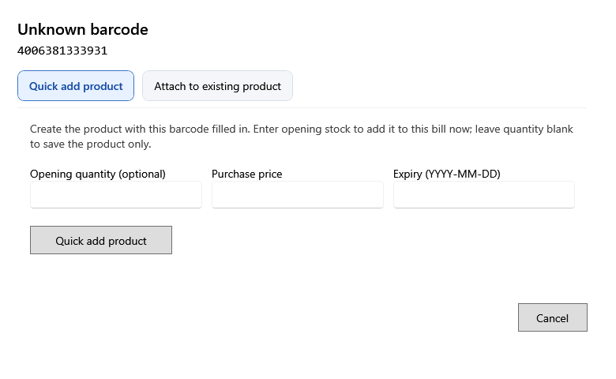

<!-- MT – needs review. Screen help for Unknown barcode (topic "unknown-barcode"); the English file is ../en/unknown-barcode.md. Bold names in a table's first column must match the Gujarati labels on screen; see ../README.md. Each tab has its own section, named as the tab. -->
# અજાણ્યો બારકોડ

સ્કેન કરેલો બારકોડ, કે લખેલો આઠ કે વધુ અંકનો નંબર, કોઈ ઉત્પાદન સાથે મળતો નથી. ઉત્પાદન અત્યારે ઉમેરો, અથવા બારકોડ તમારી પાસેના ઉત્પાદન સાથે જોડો.

લખેલું ઉત્પાદનનું નામ આ વિન્ડો ક્યારેય ખોલતું નથી, એટલે નામ ક્યારેય બારકોડ તરીકે સચવાતું નથી. **રદ કરો** ફેરફાર વગર તેને બંધ કરે છે.

## ઉત્પાદન ઝડપથી ઉમેરો

આ બારકોડ ભરેલો હોય એવું ઉત્પાદન બનાવે છે. અત્યારે આ બિલમાં વેચવા શરૂઆતનો સ્ટોક લખો; ફક્ત ઉત્પાદન સાચવવા જથ્થો ખાલી રાખો.

| ખાનું | અર્થ |
|---|---|
| **શરૂઆતનો જથ્થો (વૈકલ્પિક)** | ઉત્પાદન સાથે નવી બેચ તરીકે ઉમેરવાનો સ્ટોક. |
| **ખરીદ કિંમત** | એ બેચ માટે એક નંગની કર પહેલાંની કિંમત. |
| **સમાપ્તિ (YYYY-MM-DD)** | બેચની મુદતની તારીખ, હોય તો. |
| **ઉત્પાદન ઝડપથી ઉમેરો** | ટૂંકું ઉત્પાદન ફોર્મ ખોલે છે, પછી ઉત્પાદન, અને જથ્થો આપ્યો હોય તો તેનો સ્ટોક, ઉમેરે છે. |

## હાલના ઉત્પાદન સાથે જોડો

| ખાનું | અર્થ |
|---|---|
| **SKU, નામ, ગુજરાતી નામ, ઉપનામ અથવા બ્રાન્ડથી શોધો** | બારકોડ જે ઉત્પાદનનો છે તે શોધો. |
| **SKU**, **નામ**, **શ્રેણી**, **સ્ટોક** | મળતાં ઉત્પાદનો. |
| **હાલના ઉત્પાદન સાથે જોડો** | બારકોડ પસંદ કરેલા ઉત્પાદનમાં ઉમેરે છે, જેથી આગલા સ્કેનમાં તે મળે. |
| **બારકોડનું ઉત્પાદન ખોલો** | બારકોડ પહેલેથી કોઈ ઉત્પાદનનો હોય ત્યારે તે ઉત્પાદન ખોલે છે. |
