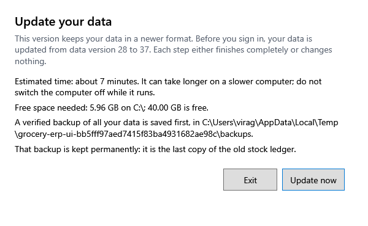

<!-- MT – needs review. Screen help for Update your data (topic "upgrade"); the English file is ../en/upgrade.md. Bold names in a table's first column must match the Gujarati labels on screen; see ../README.md. -->
# તમારો ડેટા અપડેટ કરો

એપ અપડેટ થયા પછી, સાઇન ઇન કરતા પહેલાં દુકાનનો ડેટા નવી આવૃત્તિ સુધી લાવો.

**હમણાં અપડેટ કરો** દબાવો નહીં ત્યાં સુધી કંઈ બદલાતું નથી. વિન્ડો કહે છે કે કેટલો સમય લાગશે, કેટલી ખાલી જગ્યા જોઈએ અને બેકઅપ ક્યાં જશે. પહેલાં બધા ડેટાનો ચકાસેલો બેકઅપ સચવાય છે; પછી દરેક પગલું કાં તો પૂરેપૂરું થાય છે અથવા કંઈ બદલતું નથી. તે ચાલતું હોય ત્યારે કમ્પ્યુટર બંધ કરશો નહીં. પૂરતી ખાલી જગ્યા ન હોય તો થોડી ખાલી કરો અને એપ ફરી શરૂ કરો.

અપડેટ અટકે તો તમારો ડેટા સુરક્ષિત છે: વિન્ડો કહે છે કે બેકઅપ અને લૉગ ફાઇલો ક્યાં છે. ફરી પ્રયાસ કરવા એપ ફરી શરૂ કરો. પાછલી આવૃત્તિ પર પાછા જવા, તે ઇન્સ્ટોલ કરો અને સેટિંગ્સમાં તે બેકઅપ રિસ્ટોર કરો.

## બટન

| બટન | શું કરે છે |
|---|---|
| **હમણાં અપડેટ કરો** | બેકઅપ સાચવે છે, પછી ડેટા અપડેટ કરે છે. |
| **બહાર નીકળો** | કંઈ બદલ્યા વગર એપ બંધ કરે છે. |
| **બેકઅપ ફોલ્ડર ખોલો** | અપડેટ અટકે ત્યારે દેખાય છે: અપડેટ પહેલાં લીધેલા બેકઅપવાળું ફોલ્ડર ખોલે છે. |
