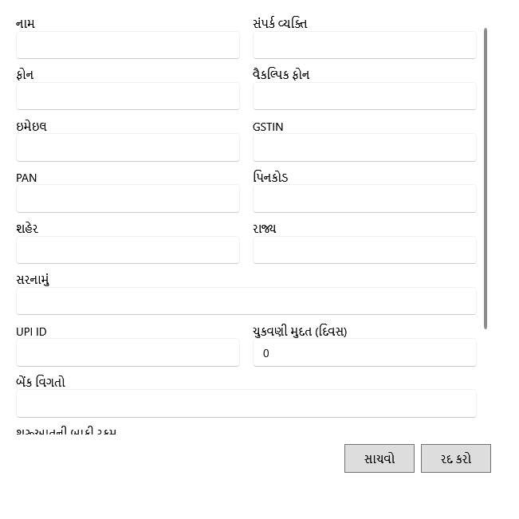

<!-- MT – needs review. Screen help for the vendor form (topic "vendor-editor"); the English file is ../en/vendor-editor.md. Bold names in a table's first column must match the Gujarati labels on screen; see ../README.md. -->
# નવો વિક્રેતા

વિક્રેતા ઉમેરો કે બદલો: સંપર્ક, કર નંબર, સરનામું અને ચુકવણીની વિગતો.

જેની સાથે * હોય તે વિગતો જરૂરી છે. સાચવવામાં તકલીફ આવે તો તેના ખાના નીચે દેખાય છે અને ઉપર યાદીમાં આવે છે; તમે લખેલું રહે છે.

## ખાનાં

| ખાનું | અર્થ |
|---|---|
| **નામ** | વિક્રેતાનું નામ, ખરીદી અને ખાતાવહી બતાવે તેમ. |
| **સંપર્ક વ્યક્તિ** | ત્યાં તમે જેની સાથે વાત કરો છો. |
| **ફોન**, **વૈકલ્પિક ફોન** | વિક્રેતાનો સંપર્ક કરવાના નંબર. |
| **ઇમેઇલ** | વિક્રેતાનું ઇમેઇલ સરનામું. |
| **GSTIN** | વિક્રેતાનો GST નંબર, 15 અક્ષર. GST સારાંશ ખરીદીનો કર તેના મુજબ જૂથ કરે છે. |
| **PAN** | વિક્રેતાનો PAN, 10 અક્ષર. |
| **સરનામું**, **શહેર**, **રાજ્ય** | વિક્રેતા ક્યાં છે. |
| **પિનકોડ** | 6 અંક. |
| **UPI ID** | વિક્રેતાને UPI થી ચૂકવવા માટે. |
| **ચુકવણી મુદત (દિવસ)** | વિક્રેતા બિલ ચૂકવવા કેટલા દિવસ આપે છે. |
| **શરૂઆતની બાકી રકમ** | એપ વાપરવાનું શરૂ કરતાં પહેલાં તમારે આ વિક્રેતાને ચૂકવવાની રકમ. તેનાથી વિક્રેતાની ખાતાવહી શરૂ થાય છે. |
| **બેંક વિગતો** | બેંકથી ચુકવણી માટે ખાતાની વિગતો. |
| **નોંધ** | રાખવા જેવી બીજી કોઈ વાત. |

## બટન

| બટન | શું કરે છે |
|---|---|
| **સાચવો** | વિક્રેતા સાચવે છે. |
| **રદ કરો** | સાચવ્યા વગર બંધ કરે છે. |
