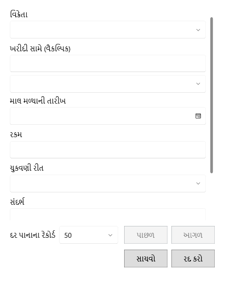

<!-- MT – needs review. Screen help for Vendor payment (topic "vendor-payment"); the English file is ../en/vendor-payment.md. Bold names in a table's first column must match the Gujarati labels on screen; see ../README.md. -->
# વિક્રેતા ચુકવણી

વિક્રેતાને ચૂકવેલા પૈસા નોંધો. તે વિક્રેતાની બાકી રકમ ઘટાડે છે.

ચૂકવવા માટે બિલ પસંદ કરો, અથવા ખાતા પર ચુકવણી માટે બિલ ખાલી રાખો.

## ખાનાં

| ખાનું | અર્થ |
|---|---|
| **વિક્રેતા** | કોને ચૂકવ્યું. |
| **ખરીદી સામે (વૈકલ્પિક)** | આ ચુકવણી જે બિલ ચૂકવે છે. ખાતા પર ચૂકવવા ખાલી રાખો. |
| **GRN કે વિક્રેતા બિલ નં.** | GRN કે બિલ નંબરથી વિક્રેતાનું બિલ શોધે છે. |
| **આગલું પાનું**, **પાછલું પાનું** | સમાય તેના કરતાં વધુ બિલ હોય ત્યારે તેમાં આગળ-પાછળ જાય છે. |
| **ચુકવણી તારીખ** | ચૂકવ્યું તે દિવસ. |
| **રકમ** | કેટલું ચૂકવ્યું. |
| **ચુકવણી રીત** | **રોકડ**, **UPI**, **બેંક**, **ચેક** અથવા **અન્ય**. |
| **સંદર્ભ** | ચેક, UPI કે બેંકનો સંદર્ભ. |
| **નોંધ** | રાખવા જેવી બીજી કોઈ વાત. |

## બટન

| બટન | શું કરે છે |
|---|---|
| **સાચવો** | ચુકવણી નોંધે છે. |
| **રદ કરો** | ફેરફાર વગર બંધ કરે છે. |
