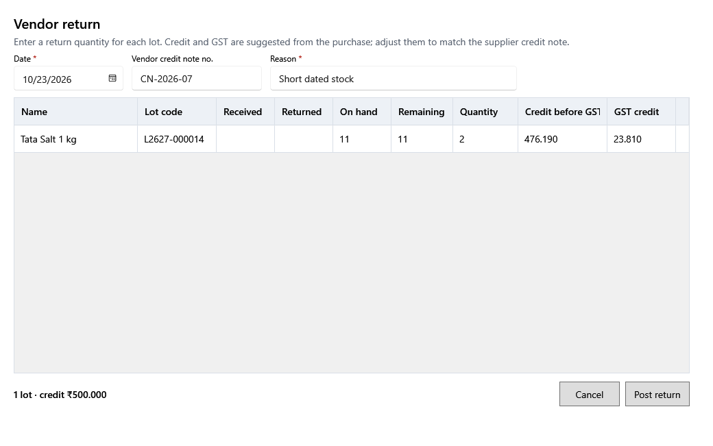

<!-- MT – needs review. Screen help for Vendor return (topic "vendor-return"); the English file is ../en/vendor-return.md. Bold names in a table's first column must match the Gujarati labels on screen; see ../README.md. -->
# વિક્રેતાને પરત

નોંધાયેલી ખરીદીનો ભાગ વિક્રેતાને પાછો મોકલો અને તેના માટે મળતી ક્રેડિટ નોંધો.

પાછી જતી દરેક બેચ માટે જથ્થો લખો. ક્રેડિટ અને કર ખરીદીમાંથી સૂચવાય છે; વિક્રેતાની ક્રેડિટ નોટ મુજબ બદલો. નોંધવાથી સ્ટોક બેચમાંથી ઘટે છે અને વિક્રેતાની બાકી રકમ ઘટે છે; પરત તેની તારીખે GST સારાંશમાં ભરેલો કર ઘટાડે છે. કંઈ બદલાય તે પહેલાં તમે પુષ્ટિ કરો છો.

## ખાનાં

| ખાનું | અર્થ |
|---|---|
| **તારીખ** | પરતનો દિવસ. તે આ તારીખે ગણાય છે. |
| **વિક્રેતા ક્રેડિટ નોટ નંબર** | વિક્રેતાની ક્રેડિટ નોટ પરનો નંબર. |
| **કારણ** | માલ કેમ પાછો જાય છે. |
| **નામ**, **બેચ કોડ** | આ ખરીદીનું ઉત્પાદન અને તેની બેચ. |
| **મળેલ** | ખરીદીથી બેચમાં કેટલું આવ્યું. |
| **પરત થયેલ** | પહેલેથી કેટલું પાછું ગયું. |
| **હાલનો જથ્થો** | બેચનો હાલનો સ્ટોક. |
| **બાકી** | હજી કેટલું પાછું જઈ શકે. |
| **જથ્થો** | અત્યારે કેટલું પાછું જાય છે, બાકી અને હાલના જથ્થા સુધી. |
| **કર પહેલાંની ક્રેડિટ** | આ એકમો માટે ક્રેડિટ, કર પહેલાં. |
| **કર ક્રેડિટ** | પાછો જમા થતો ખરીદી કર. |

## બટન

| બટન | શું કરે છે |
|---|---|
| **પરત નોંધો** | તમે પુષ્ટિ કરો પછી પરત નોંધે છે. |
| **રદ કરો** | ફેરફાર વગર બંધ કરે છે. |
