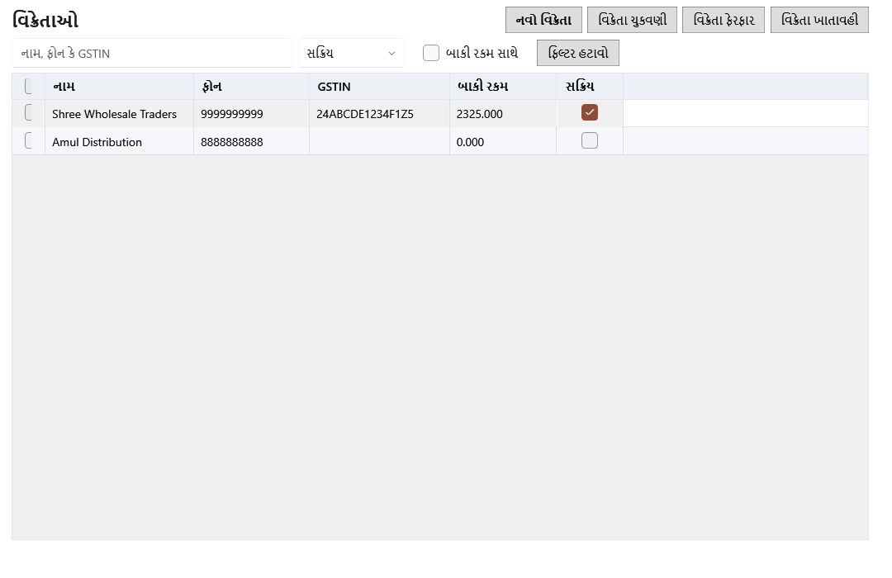

<!-- MT – needs review. Screen help for Vendors (topic "vendors"); the English file is ../en/vendors.md. Bold names in a table's first column must match the Gujarati labels on screen; see ../README.md. -->
# વિક્રેતાઓ

વિક્રેતાઓની વિગતો રાખો, દરેકને કેટલું ચૂકવવાનું છે તે જુઓ, ચુકવણી નોંધો અને દરેક વિક્રેતાની ખાતાવહી વાંચો.

વિક્રેતાની બાકી રકમ એટલે પ્રારંભિક બાકી વત્તા નોંધાયેલી ખરીદી, બાદ ચુકવણી અને વિક્રેતાને પરત. ખરીદી રદ કરવાથી કે પરત રદ કરવાથી પણ તે બદલાય છે.

## ફિલ્ટર

| ખાનું | અર્થ |
|---|---|
| **નામ, ફોન કે GSTIN** | વિક્રેતાના નામ, ફોન નંબર કે GSTIN નો ભાગ લખો. Ctrl+F અહીં લાવે છે. |
| **સ્થિતિ** | **સક્રિય**, **નિષ્ક્રિય** અથવા **બધી સ્થિતિ**. નિષ્ક્રિય વિક્રેતા નવી ખરીદી માટે પસંદ થઈ શકતા નથી; તેમનો ઇતિહાસ રહે છે. |
| **બાકી રકમ સાથે** | ફક્ત એવા વિક્રેતા જેમને હજી પૈસા ચૂકવવાના છે. |
| **ફિલ્ટર હટાવો** | દરેક ફિલ્ટર તેની મૂળ સ્થિતિમાં લાવે છે. |

## કોષ્ટક

| કૉલમ | અર્થ |
|---|---|
| **આ પાનું પસંદ કરો**, **વિક્રેતા પસંદ કરો** | પસંદગીનાં ખાનાં. હરોળ પસંદ કરતાં નીચેની પટ્ટીમાં પસંદગી પટ્ટી ખૂલે છે. |
| **નામ** | વિક્રેતાનું નામ. |
| **ફોન** | વિક્રેતાનો ફોન નંબર. |
| **GSTIN** | વિક્રેતાનો GST નંબર. |
| **બાકી રકમ** | હાલમાં વિક્રેતાને ચૂકવવાની રકમ. |
| **સક્રિય** | વિક્રેતા નવી ખરીદી માટે પસંદ થઈ શકે કે નહીં. |

## બટન

| બટન | શું કરે છે |
|---|---|
| **નવો વિક્રેતા** | વિક્રેતાનું ફોર્મ ખોલે છે (Ctrl+N): નામ, સંપર્ક, ફોન, ઇમેઇલ, સરનામું, GSTIN, PAN, પિનકોડ, UPI કે બેંક વિગતો, ચુકવણીની શરતો અને પ્રારંભિક બાકી. |
| **વિક્રેતા ચુકવણી** | વિક્રેતાને કરેલી ચુકવણી નોંધે છે, જરૂર હોય તો એક બિલ સામે: તારીખ, રકમ, રીત, સંદર્ભ અને નોંધ. તે બાકી રકમ ઘટાડે છે. |
| **વિક્રેતા ફેરફાર** | પસંદ કરેલા વિક્રેતાનું ફોર્મ ખોલે છે. |
| **વિક્રેતા ખાતાવહી** | પસંદ કરેલો વિક્રેતા પૅનલમાં ખોલે છે (Enter કે ડબલ-ક્લિક). |

## પસંદ કરેલા વિક્રેતા

| ખાનું | અર્થ |
|---|---|
| **પસંદગી સાફ કરો** | દરેક વિક્રેતાની પસંદગી કાઢે છે. |
| **બધા મળતા પરિણામો પસંદ કરો** | બધાં પાનાં પર ફિલ્ટરને મળતો દરેક વિક્રેતા પસંદ કરે છે. |
| **સમૂહ ક્રિયાઓ ▾** | પસંદ કરેલા બધા વિક્રેતા એક સાથે બદલે છે. |
| **પસંદ કરેલા સક્રિય કરો**, **પસંદ કરેલા નિષ્ક્રિય કરો** | પસંદ કરેલા વિક્રેતાને સક્રિય કે નિષ્ક્રિય કરે છે. નિષ્ક્રિય વિક્રેતા નવી ખરીદીમાં દેખાતા નથી; તેમનો ઇતિહાસ રહે છે. |

## વિક્રેતાની પૅનલ

તમે બદલો નહીં ત્યાં સુધી પૅનલ પૂરી પહોળાઈમાં ખૂલે છે. એ ખુલ્લી હોય ત્યારે **વિક્રેતા ફેરફાર** અને **વિક્રેતા ચુકવણી** પૅનલમાં હોય છે. દરેક ટૅબનાં પાનાનાં તીર પૅનલની નીચેની પટ્ટીમાં છે, નવાં પહેલાં.

| ખાનું | અર્થ |
|---|---|
| **પાછલી નોંધ**, **આગળની નોંધ** | યાદીમાં ઉપરનો કે નીચેનો વિક્રેતા ખોલે છે. |
| **પૂરી પહોળાઈ વાપરો**, **યાદીની બાજુમાં બતાવો** | પૅનલને આખા પાના અને યાદીની બાજુ વચ્ચે બદલે છે. સ્ક્રીન આ પસંદગી યાદ રાખે છે. |
| **બંધ કરો** | પૅનલ બંધ કરે છે (Esc). |

## ખરીદી

| કૉલમ | અર્થ |
|---|---|
| **તારીખ** | ખરીદીનો માલ મળ્યાની તારીખ. |
| **દસ્તાવેજ** | GRN નંબર. |
| **કુલ** | ખરીદીનો કુલ, જે વિક્રેતાની બાકી રકમમાં ઉમેરાય છે. |
| **બાકી રકમ** | આ નોંધ પછી વિક્રેતાની બાકી રકમ. |

## ચૂકવણીઓ

| કૉલમ | અર્થ |
|---|---|
| **તારીખ** | ચુકવણીની તારીખ. |
| **સંદર્ભ** | ચુકવણીનો સંદર્ભ, જેમ કે ચેક કે UPI નંબર. |
| **રકમ** | ચૂકવેલી રકમ. |
| **બાકી રકમ** | આ નોંધ પછી વિક્રેતાની બાકી રકમ. |

## વિક્રેતાને પરત કરેલા માલ

| કૉલમ | અર્થ |
|---|---|
| **તારીખ** | પરતની તારીખ. |
| **દસ્તાવેજ** | વિક્રેતા પરતનો નંબર. |
| **જમા** | પાછા મોકલેલા માલ માટે વિક્રેતા જેટલું જમા આપે છે. |
| **બાકી રકમ** | આ નોંધ પછી વિક્રેતાની બાકી રકમ. |

## વિક્રેતા ખાતાવહી

બધી નોંધ સાથે: ખરીદી, રદ કરેલી ખરીદી, ચુકવણી, પરત અને રદ કરેલાં પરત.

| કૉલમ | અર્થ |
|---|---|
| **તારીખ** | નોંધની તારીખ. |
| **નોંધનો પ્રકાર** | ખરીદી, રદ કરેલી ખરીદી, ચુકવણી, વિક્રેતાને પરત અથવા રદ કરેલું પરત. |
| **દસ્તાવેજ** | GRN, ચુકવણીનો સંદર્ભ કે પરતનો નંબર. |
| **ઉધાર** | નોંધ બાકી રકમમાં જે ઉમેરે છે: ખરીદી, અથવા રદ કરેલું પરત. |
| **જમા** | નોંધ જે બાદ કરે છે: ચુકવણી, પરત અથવા રદ કરેલી ખરીદી. |
| **બાકી રકમ** | આ નોંધ પછી વિક્રેતાની બાકી રકમ. |

## પૂરી પાડેલી બેચ

| કૉલમ | અર્થ |
|---|---|
| **નામ** | ઉત્પાદન. |
| **બેચ કોડ** | બેચ માટે દુકાનનો કોડ. |
| **બેચ નંબર** | સપ્લાયરનો બેચ નંબર. |
| **માલ મળ્યાની તારીખ** | બેચ આવી તે દિવસ. |
| **સમાપ્તિ** | બેચની સમાપ્તિ તારીખ. |
| **હાલનો જથ્થો** | બેચમાં બાકી જથ્થો. |

## કેવી રીતે વાપરવું

1. પહેલી ખરીદી પહેલાં **નવો વિક્રેતા** વડે વિક્રેતા ઉમેરો.
2. કોને ચૂકવવાનું છે તે જોવા **બાકી રકમ સાથે** પસંદ કરો.
3. ખરીદી, ચુકવણી અને પરત તપાસવા વિક્રેતાની ખાતાવહી ખોલો.
4. દરેક ચુકવણી **વિક્રેતા ચુકવણી** વડે નોંધો.
